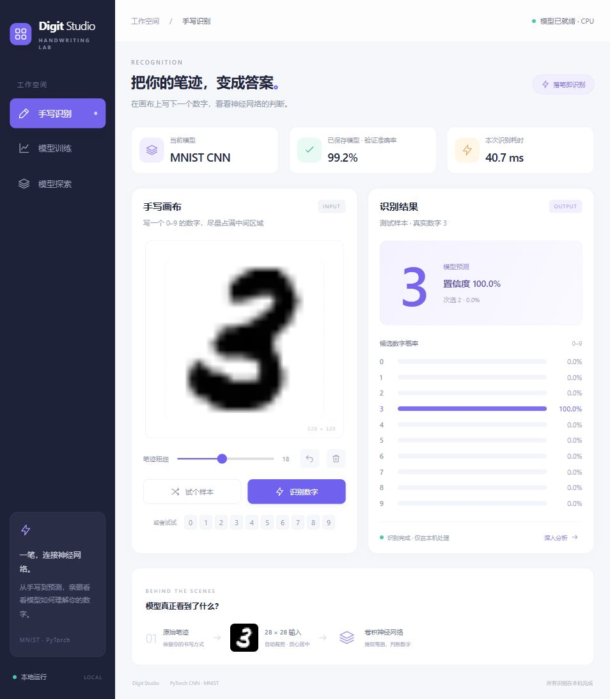

# Digit Studio · 手写数字实验室

在本机运行的手写数字识别、模型训练与探索工作台。独立 HTML Canvas 界面，FastAPI 服务，PyTorch CNN；无需 Node.js 或前端构建。



## 快速启动

在项目根目录执行：

```powershell
python -m venv .venv
.venv\Scripts\python.exe -m pip install -r mnist_web\requirements.txt
```

Windows 双击 `mnist_web/start.bat`，服务就绪后自动打开默认浏览器。也可运行：

```powershell
.venv\Scripts\python.exe mnist_web\app.py --open-browser
```

网页右上角「关闭服务」可停止后台；正在训练时先停止并保存。只关闭网页不会停止服务。

macOS/Linux 使用 `.venv/bin/python` 运行相同 Python 入口。

## 功能与文档

- 手写识别：画布、撤销、笔迹粗细、样本快捷选择、十类概率及真实模型输入预览。
- 模型训练：配置参数、训练/验证曲线、停止并保存、日志和离线报告。
- 模型探索：卷积特征图、模型摘要、1,000 张均衡测试样本的混淆矩阵。
- [安装、使用与项目文件说明](mnist_web/README.md)
- [47 页详细 PDF 说明书](output/pdf/Digit_Studio_Project_Manual.pdf)
- [说明书文字源稿](output/pdf/manual_content.md)
- [开发交接记录](PROJECT_HANDOFF.md)

仓库包含现有 `mnist_web/mnist_cnn.pth`，安装后可直接识别。MNIST 数据首次需要时自动下载至 `mnist_web/data/`，不提交数据缓存和虚拟环境。

新训练从新模型开始，会覆盖当前权重；顶部准确率是历史验证记录，不能等同于任意用户笔迹准确率。模型针对单个 0–9 数字，不支持完整 OCR 或多位数字识别。

## 测试

```powershell
cd mnist_web
..\.venv\Scripts\python.exe -m unittest discover -s tests -v
```

当前基线 9 项测试通过；临时训练测试不会覆盖现有模型。
